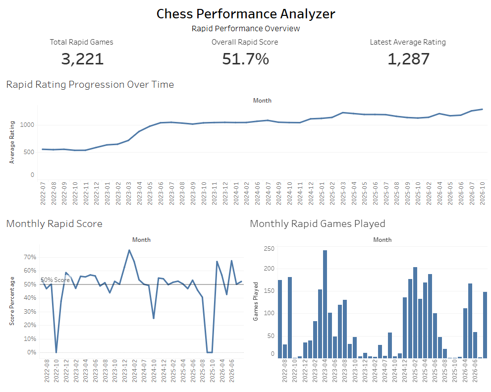

# Chess Performance Analyzer


An end-to-end data analytics project using Python, MySQL, and Tableau Public to analyze my Chess.com Rapid performance over time.


## Project Overview


This project collects my Chess.com game history, cleans and transforms the data with Python, stores the results in MySQL, and uses SQL queries to analyze performance trends, opening results, and playing habits.


## Tools & Technologies


- **Python:** API data collection, data cleaning, validation, and CSV exports

- **MySQL:** Data storage, SQL analysis, aggregations, and views

- **Tableau Public:** Interactive performance dashboard

- **Chess.com Published Data API:** Game archive source


## Dataset


- **Player:** `xkevl`

- **Rated games collected:** 3,267

- **Rapid games analyzed:** 3,221

- **Date range:** July 2022 - October 2026

- **Results:** 1,577 wins, 1,470 losses, and 174 draws across Rapid games


The dataset contains game dates, player and opponent ratings, results, colors played, time controls, opening information, and game links.


## SQL Analysis & Key Findings

### 1. Rapid Rating Progression

Monthly SQL aggregations showed that average Rapid rating increased from **553 in July 2022 to 1,287 in October 2026**, representing a **734-point increase (133%)**.

This indicates substantial long-term improvement, although monthly averages can fluctuate depending on game volume and performance.

### 2. Overall Rapid Performance

Across **3,221 rated Rapid games**, the player recorded:

- **1,577 wins**
- **1,470 losses**
- **174 draws**
- **51.7% score percentage**, with draws counted as half a point

The score percentage provides a more complete measure of competitive results than win rate alone because it accounts for drawn games.

### 3. Performance by Piece Color

SQL analysis identified a performance gap between playing White and Black:

- **White win rate:** approximately 53.0%
- **Black win rate:** approximately 44.9%
- **Difference:** approximately 8.1 percentage points

This suggests that playing Black may be an area for further investigation, particularly in opening preparation and defensive play. However, the difference alone does not establish its cause.

### Analytical Takeaways

These analyses demonstrate the use of SQL aggregations, conditional calculations, grouping, and time-based analysis to identify performance trends and opportunities for improvement.

The full SQL queries are available in [`sql/analysis_queries.sql`](sql/analysis_queries.sql).


## Tableau Dashboard


[View the Chess Performance Analyzer dashboard](https://public.tableau.com/app/profile/kevin.lim7109/viz/ChessPerformanceAnalyzer/ChessPerformanceDashboard)


### Dashboard Preview




The dashboard includes:

- Rapid rating progression over time

- Monthly Rapid score percentage, with a 50% reference line

- Monthly Rapid game volume

- Total Rapid games, overall score, and latest monthly rating


## Project Structure


```text
chess-performance-analyzer/
|-- data/
|   `-- monthly_rapid_performance.csv
|-- sql/
|   `-- analysis_queries.sql
|-- clean_games.py
|-- download_games.py
|-- import_games_to_mysql.py
|-- inspect_games.py
|-- test_mysql_connection.py
|-- .gitignore
`-- README.md
```


Raw archives and the full cleaned dataset are excluded from version control.


## How It Works


1. Download game archives from the Chess.com Published Data API.

2. Inspect archive contents and game metadata.

3. Clean and standardize game records with Python.

4. Import the cleaned data into the `chess_analytics` MySQL database.

5. Run SQL analyses and create a monthly performance view.

6. Export monthly results and visualize them in Tableau Public.


## Running the Project


The Python scripts require Python and the dependencies used by the project. MySQL is required to run the database import and SQL analyses.


1. Clone this repository.

2. Install the required Python packages.

3. Configure database connection settings locally.

4. Download the game archives and run the cleaning script.

5. Create the `chess_analytics` database and import the cleaned data.

6. Run the SQL queries and connect the exported monthly results to Tableau Public.


Do not commit database passwords, API keys, or local environment files.


## Future Improvements


- Analyze rating changes and performance by time control.

- Compare opening results using minimum sample-size thresholds.

- Investigate performance by opponent rating and game duration.

- Expand the Tableau dashboard with additional analytical views.
